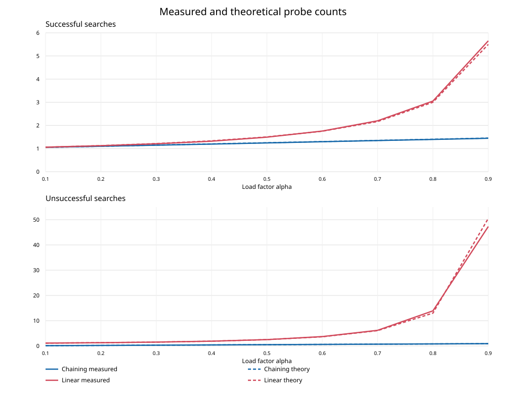

# Chaining vs. linear probing

Both implementations use capacity 2000 and the identical keys and absent queries within each of 20 seeded trials at every load factor. Successful averages query each stored key once in shuffled order; unsuccessful averages query the same number of absent keys.

Theoretical estimates: chaining success `1 + α/2`, failure `α`; linear probing success `0.5 × (1 + 1/(1−α))`, failure `0.5 × (1 + 1/(1−α)^2)`.

| α | Chaining success | Theory | Chaining failure | Theory | Linear success | Theory | Linear failure | Theory |
|---:|---:|---:|---:|---:|---:|---:|---:|---:|
| 0.1 | 1.054 | 1.050 | 0.104 | 0.100 | 1.060 | 1.056 | 1.124 | 1.117 |
| 0.2 | 1.100 | 1.100 | 0.204 | 0.200 | 1.123 | 1.125 | 1.287 | 1.281 |
| 0.3 | 1.146 | 1.150 | 0.294 | 0.300 | 1.206 | 1.214 | 1.522 | 1.520 |
| 0.4 | 1.194 | 1.200 | 0.394 | 0.400 | 1.317 | 1.333 | 1.872 | 1.889 |
| 0.5 | 1.243 | 1.250 | 0.498 | 0.500 | 1.493 | 1.500 | 2.493 | 2.500 |
| 0.6 | 1.295 | 1.300 | 0.597 | 0.600 | 1.756 | 1.750 | 3.697 | 3.625 |
| 0.7 | 1.347 | 1.350 | 0.698 | 0.700 | 2.199 | 2.167 | 6.178 | 6.056 |
| 0.8 | 1.395 | 1.400 | 0.797 | 0.800 | 3.052 | 3.000 | 13.904 | 13.000 |
| 0.9 | 1.445 | 1.450 | 0.897 | 0.900 | 5.652 | 5.500 | 47.284 | 50.500 |

The SVG separates successful and unsuccessful search scales so both strategies remain readable. Finite seeded trials and realized bucket layouts cause deviations from theory. Linear probing's costs rise sharply near load 1 because primary clustering creates long runs; chaining grows more gradually.

The two-page summary is in [report.pdf](report.pdf).
