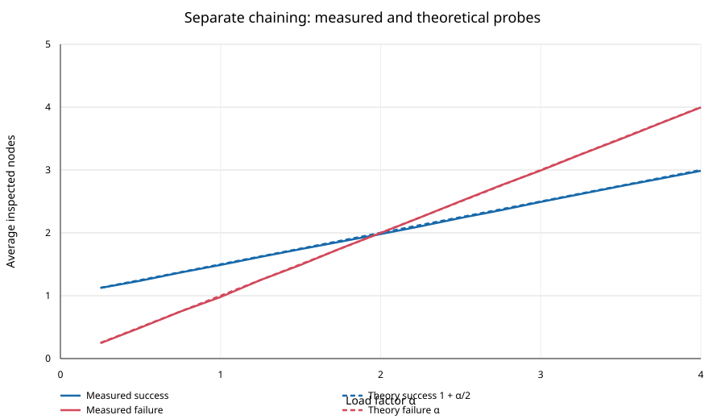

# Separate-chaining probe experiment

Capacity: 4000. Each row averages α × capacity successful and unsuccessful searches. Seeded independent bucket assignments give reproducible, approximately uniform key and query distributions.

| α | successful measured | successful theory (1 + α/2) | unsuccessful measured | unsuccessful theory (α) |
|---:|---:|---:|---:|---:|
| 0.25 | 1.124 | 1.125 | 0.245 | 0.250 |
| 0.50 | 1.238 | 1.250 | 0.492 | 0.500 |
| 0.75 | 1.369 | 1.375 | 0.749 | 0.750 |
| 1.00 | 1.490 | 1.500 | 0.980 | 1.000 |
| 1.25 | 1.618 | 1.625 | 1.250 | 1.250 |
| 1.50 | 1.741 | 1.750 | 1.489 | 1.500 |
| 1.75 | 1.860 | 1.875 | 1.752 | 1.750 |
| 2.00 | 1.980 | 2.000 | 1.999 | 2.000 |
| 2.25 | 2.105 | 2.125 | 2.248 | 2.250 |
| 2.50 | 2.237 | 2.250 | 2.505 | 2.500 |
| 2.75 | 2.360 | 2.375 | 2.757 | 2.750 |
| 3.00 | 2.492 | 2.500 | 2.993 | 3.000 |
| 3.25 | 2.618 | 2.625 | 3.248 | 3.250 |
| 3.50 | 2.743 | 2.750 | 3.493 | 3.500 |
| 3.75 | 2.864 | 2.875 | 3.746 | 3.750 |
| 4.00 | 2.987 | 3.000 | 3.997 | 4.000 |

The theoretical expressions assume uniformly distributed keys and, for successful searches, a uniformly selected stored key. Independent seeded bucket assignments approximate these assumptions; finite table size and the realized bucket occupancy cause small deviations. An empty bucket costs zero probes, which is included in the unsuccessful-search average.

